<div align="center">


<a href="https://github.com/Adimeena06">
  
</a>

<br/>

<a href="https://github.com/Adimeena06"></a>
<a href="https://www.linkedin.com/in/aditya-meena-3ba22b326"></a>
<a href="mailto:Adityameena0605@gmail.com"></a>


</div>

<br/>


<div align="center">
</div>

<p align="center">
I build <b>intelligent systems</b> and <b>decentralized applications</b>: computer-vision pipelines, FastAPI services, React front-ends and Solidity / Motoko smart contracts.<br/>
Currently pursuing an <b>MCA in Artificial Intelligence &amp; Machine Learning</b>, after a <b>BCA in AI &amp; ML</b> at Sharda University (2023–2026).<br/>
My focus: turning research-grade ideas into working products at the intersection of <b>AI × Blockchain × Web3</b>.
</p>

<br/>


<div align="center">
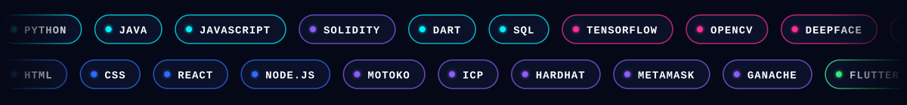

<br/><br/>

<br/>
<br/>
<sub><code>PYTHON · JAVA · JAVASCRIPT · SOLIDITY · DART · SQL</code></sub>

<br/><br/>

<br/>

<br/>
<sub><code>TENSORFLOW · OPENCV · DEEPFACE · FASTAPI · FLASK</code></sub>

<br/><br/>

<br/>
<br/>
<sub><code>HTML · CSS · REACT · NODE.JS</code></sub>

<br/><br/>

<br/>


<br/>
<sub><code>SOLIDITY · MOTOKO · ICP · HARDHAT · METAMASK · GANACHE</code></sub>

<br/><br/>

<br/>
<br/>
<sub><code>FLUTTER · FIREBASE</code></sub>

<br/><br/>

<br/>
<br/>
<sub><code>GIT · GITHUB · VS CODE · MYSQL · POWER BI</code></sub>
</div>

<br/>


<div align="center">

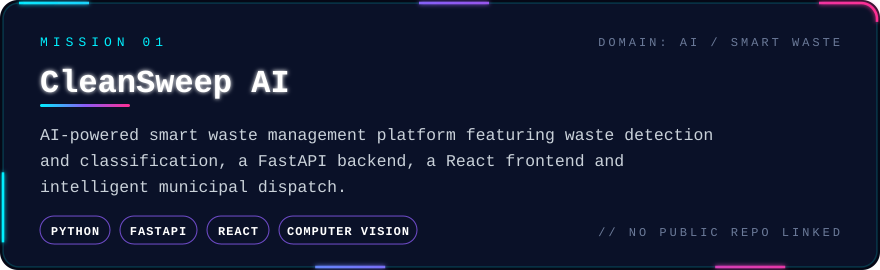

<br/><br/>

<a href="https://github.com/Adimeena06/organ-donation-blockchain">
  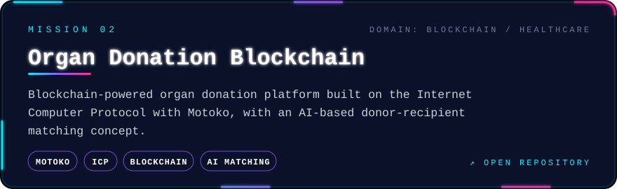
</a>

<br/><br/>

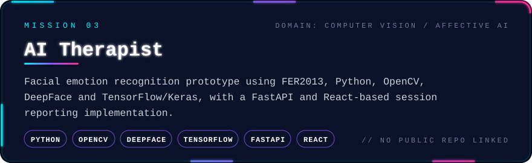

<br/><br/>

<a href="https://github.com/Adimeena06/REMIX">
  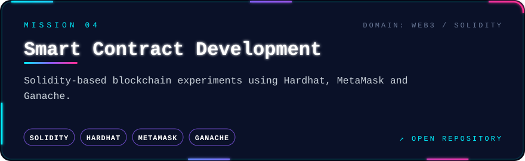
</a>

</div>

```bash
$ git clone https://github.com/Adimeena06/organ-donation-blockchain.git
$ git clone https://github.com/Adimeena06/REMIX.git
```

<br/>


<div align="center">

<a href="https://github.com/Adimeena06">
  
</a>
<a href="https://github.com/Adimeena06?tab=repositories">
  
</a>

<br/>


<br/>


<br/>


<br/><br/>

<picture>
  <source media="(prefers-color-scheme: dark)" srcset="https://raw.githubusercontent.com/Adimeena06/Adimeena06/output/github-snake-dark.svg" />
  <source media="(prefers-color-scheme: light)" srcset="https://raw.githubusercontent.com/Adimeena06/Adimeena06/output/github-snake.svg" />
  
</picture>

</div>

<br/>


<div align="center">
</div>

<br/>


<p align="center">
Open to <b>AI &amp; Blockchain projects</b>, <b>research collaboration</b>, <b>open-source contributions</b> and serious opportunities.<br/>
Have a problem worth solving? Open a channel.
</p>

<div align="center">
<a href="https://github.com/Adimeena06"></a>
<a href="https://www.linkedin.com/in/aditya-meena-3ba22b326"></a>
<a href="mailto:Adityameena0605@gmail.com"></a>
</div>

<br/>

<div align="center">


</div>
